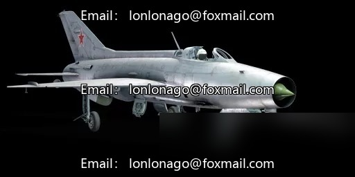

# Mig-21 weapon system technical document

## Body

1. MiG-21 weapon system technical document 1, MiG-21F-13 "Technical Description · Volume 3 · Aircraft Structure", page 277, DJVU format
2. MiG-21ПФМ aircraft operation guide, Volume 2, specifically for weapon system operations. Page 171
3. MiG-21Ф-13 aircraft technical description, Volume 2, weapon), mainly introducing the technical details of the weapon system for this model aircraft. Page 172

11106
71582
UM20A

The Mig-21 weapon system technical documentation includes the Technical Description for the aircraft structure, an operation guide and an aircraft technical description.

<!-- AI_ENRICHED -->

## Images

## Payment

Here is a pay link on Stripe ( https://buy.stripe.com/3cs8yP7sY87d0vu9AB ). Please contact me lonlonago@foxmail.com after funding $89, and I will send you a complete data files , thank you!

